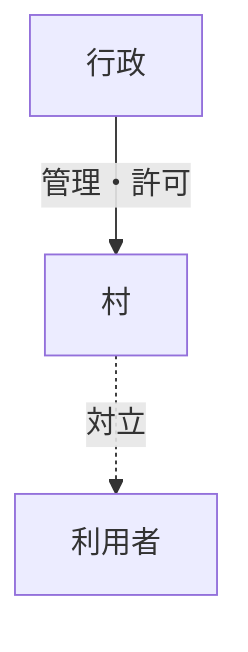

# fix/heading-adjacent-fenced-code — 調査記録と実機確認チェックリスト

状態：実装完了・ユーザー実機確認待ち（ブランチ `fix/heading-adjacent-fenced-code`、基点 `c6cb245` = 1.1.0、未コミット）

## 1. 調査結果（コード／テストで確認した事実）

| 段階 | 結果 |
|---|---|
| parseDocument（section／fence 行判定） | 正常。見出し直後・空行なしの fence も L2〜L6 を `codeBlockLines` として認識し、section は L1〜L9 を包含する |
| scanFencedCodeBlocks（範囲・親） | 正常。`fenced-0 1-5 parent=sec-0 supported mermaid`。閉じフェンス後の画像・`---` は含まない |
| composite 判定 | 関与しない（既定ルールに fenced-code を含むものはない） |
| Outline Tree 投影 | `showFencedCodeInOutline` が on のときのみ section 直下に1行投影される。**既定値は off**。Minji Vault の設定値も off |
| Tree 右クリックメニュー | fenced-code 行には Phase 5E-1 以来「部分編集ペインで開く」「移動」「削除」等がある |
| 本文エディタのコマンド「部分編集ペインを開く」 | **不足**。コード行は `resolveCurrentBlock` が移動系の理由 `code-block` で拒否し、「コードブロック内では移動できない」という無関係な通知が出るだけで、コード単体の Partial Edit に到達する経路がなかった（修正済み） |
| 設定の説明文 | **誤記**。「読み取り専用、編集・移動・削除は一切できない」と書かれており、実装（Partial Edit・移動・削除が可能）と矛盾していた（修正済み） |
| Apply の書き戻し | 範囲外は不変。ただし開始行は常に「フェンス＋半角スペース＋info string」に再構築されるため、`` ```mermaid `` は `` ``` mermaid `` になる（Phase 5E-3 設計メモで明記された既存仕様。変更は追加承認事項） |

報告画面（見出し行から開いた「編集中（セクション）」に見出し・Mermaid・画像・区切りが含まれる）は、section 全体編集の正常な動作である。

## 2. 修正内容

- `src/resolver/resolvePartialEditTargetAtCursor.ts`（新規）：コード行なら supported な fenced-code 単体、それ以外は従来どおり owning section。未閉鎖／境界不確実な fence は `code-block-unresolved` で拒否し、section へフォールバックしない。
- `src/main.ts` `openPartialEditForCursor`：上記 resolver を使用。コマンド ID は不変。
- `src/i18n.ts`：コマンド名を「現在のセクションまたはコードブロックの部分編集ペインを開く」に変更、専用通知 `reason.partial-edit-code-block-unresolved` を追加、コード／表の表示設定の説明文を実装どおりに修正。
- README／README.ja／CHANGELOG（Unreleased）を更新。

## 3. 実機確認用フィクスチャ

以下を検証用 Vault の Test フォルダに新規ノートとして置く（研究ノートでは行わない）。

````markdown
### 構造図解（Mermaid連携）

![[nakano_magusaba_riot.png]]
---

### 次のセクション
次のセクションの本文
````

## 4. チェックリスト（Pass / Fail / Not tested と観察メモ）

| # | 操作 | 期待結果 | 結果 | メモ |
|---|---|---|---|---|
| 1 | 設定「アウトラインツリーにコードブロックを表示」off のまま Tree を見る | 見出し2行のみ。コード行は出ない（意図した非表示） | | |
| 2 | 同設定の説明文を読む | 右クリックで部分編集・移動・削除ができる旨と、off 時のコマンド経路が書かれている | | |
| 3 | 設定 off のまま、Mermaid の `graph TD` 行にカーソルを置き、コマンドパレット「現在のセクションまたはコードブロックの部分編集ペインを開く」 | ペインにコード本文3行のみ。見出し・画像・`---` を含まない。言語セレクタが mermaid | | |
| 4 | 見出し行にカーソルを置いて同コマンド | 「編集中（セクション）」で見出し〜空行（L1〜L9）が開く（従来どおり） | | |
| 5 | 画像行にカーソルを置いて同コマンド | section 全体が開く（従来どおり） | | |
| 6 | 設定 on にする | 「構造図解」の子として `Mermaid: graph TD` 行が1つだけ出る。次のセクション配下には出ない | | |
| 7 | その行を右クリック（iPad は長押し）→「部分編集ペインで開く」 | #3 と同じ内容が開く | | |
| 8 | #3 または #7 で `graph TD` を `graph LR` に変えて Apply | 変更はコード内のみ。見出し・画像・`---`・次のセクションは不変。開始行は `` ``` mermaid ``（空白1個挿入、既存仕様） | | |
| 9 | 編集後 Apply せず Cancel／Close | 原文不変 | | |
| 10 | ペインを開いたまま本文側でコードを書き換えてから Apply | 競合として拒否され、原文は書き換わらない | | |
| 11 | 閉じフェンスを消して未閉鎖にし、コード内で同コマンド | 「このコードブロックは部分編集ペインで開けない」通知。ペインは開かない | | |
| 12 | 見出し行の右クリック →「部分編集ペインで開く」 | section 全体（従来どおり） | | |

完了判定：1〜12 がすべて Pass。
